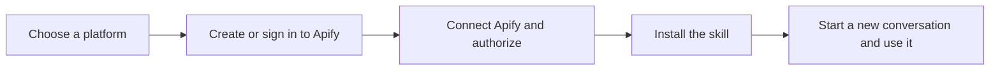

# User guide

This guide helps you choose a platform and start with the available [Instagram Transcript Extractor](skills/instagram-transcript-extractor.md). The project currently has one available skill; future ideas are listed in the [project README](../README.md), not as installable features.

## The common setup flow

In words: choose ChatGPT, Codex, Manus, or Claude web; create or sign in to your own Apify account; connect Apify in that platform and authorize access; install the Instagram Transcript Extractor Skill; then start a conversation and request a transcript. Follow the platform-specific guide because its connection and installation steps differ.

The Apify plugin/MCP connection provides access to external Apify tools and account authorization. The Skill provides instructions for the transcript task. Installing the Skill does not connect Apify, and connecting Apify does not install the Skill.

## Choose a guide

- [ChatGPT](platforms/chatgpt.md): connect and authorize Apify first, then upload the Skill ZIP.
- [Codex](platforms/codex.md): separate instructions for the Codex desktop app and Codex CLI, followed by the Skill installation and discovery check.
- [Manus](platforms/manus.md): enable the Apify Connector, import the Skill from GitHub, and select it in chat.
- [Claude web](platforms/claude-web.md): connect Apify, upload the named Skill ZIP, and select the Skill and Connector in chat.
- [Instagram Transcript Extractor](skills/instagram-transcript-extractor.md): what to request, what a result means, and common limitations.

These guides distinguish published platform instructions from this project's test evidence. See the [platform evidence matrix](platform-support.md) and [detailed test status](test-status.md) for what has and has not been tested.
