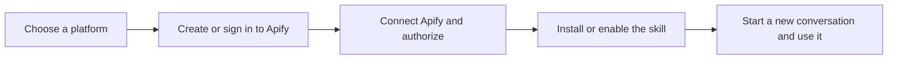

# User guide

This guide helps you choose between two Instagram Skills and find their platform setup instructions:

- [Instagram Transcript Extractor](skills/instagram-transcript-extractor.md) retrieves speech transcripts from public Instagram videos and supports transcript-based summaries, translations, and analysis.
  - Available as the separate [GitHub ZIP v0.2.1](https://github.com/apismith-labs/instagram-ai-agent-skills/releases/download/v0.2.1/instagram-transcript-extractor-v0.2.1.zip) for Skill-upload platforms and on [ClawHub 1.0.1](https://clawhub.ai/apismith-labs/skills/instagram-transcript-extractor) for OpenClaw.
- [Instagram Creator Reels Insights](skills/instagram-creator-reels-insights.md) provides recent creator-video insights based on returned posts and transcripts.
  - Its [Creator installation table](../README.md#instagram-creator-reels-insights) lists distinct routes for ChatGPT, Claude Web, OpenClaw, Codex, Manus, Claude Desktop, and Claude Code.
  - The [GitHub ZIP v1.0.1](https://github.com/apismith-labs/instagram-ai-agent-skills/releases/download/v1.0.1/instagram-creator-reels-insights-v1.0.1.zip) is for platforms that accept Skill package uploads; the separate [ClawHub listing v1.0.1](https://clawhub.ai/apismith-labs/skills/instagram-creator-reels-insights) is the OpenClaw route.
  - The ClawHub installation and full task flow have not been confirmed in the project's OpenClaw Gateway; see the [OpenClaw instructions](platforms/openclaw.md#instagram-creator-reels-insights).

Each Skill has its own installation path. Connecting Apify is a separate setup step from installing a Skill.

## The common setup flow

In words: choose a platform and Skill; create or sign in to your own Apify account; connect Apify and install or enable that Skill as supported in the environment; then start a conversation and make a request. Some clients reuse account-level setup. Follow the platform-specific guide because setup steps differ by environment.

The Apify plugin/MCP connection provides access to external Apify tools and account authorization. Each Skill provides instructions for its own task workflow. Installing a Skill does not connect Apify, and connecting Apify does not install a Skill.

## Choose a guide

- [ChatGPT](platforms/chatgpt.md): connect and authorize Apify first, then upload the ZIP for the Skill you need.
- [Codex](platforms/codex.md): separate instructions for the Codex desktop app and Codex CLI, followed by the Skill installation and discovery check.
- [Manus](platforms/manus.md): enable the Apify Connector, import the Skill from GitHub, and select it in chat.
- [Claude Web, Claude Desktop regular chat, and Claude Code](platforms/claude-web.md): set up Apify and upload the Skill in Claude Web, use the same account in Claude Desktop regular chat, or follow the separate Claude Code setup instructions.
- [OpenClaw](platforms/openclaw.md):
  - **Instagram Transcript Extractor:** choose its [ClawHub route](platforms/openclaw.md#install-with-the-openclaw-cli-from-clawhub), Control UI, GitHub-source, Vercel Skills CLI, or local-directory route.
  - **Instagram Creator Reels Insights:** use its separate [ClawHub v1.0.1 route](platforms/openclaw.md#instagram-creator-reels-insights); its GitHub ZIP is for package-upload platforms, not OpenClaw. The ClawHub installation and full task flow are not confirmed in the project Gateway.
  - Install and connect the Apify plugin separately using [Set up the Apify plugin](platforms/openclaw.md#set-up-the-apify-plugin).
- [Instagram Transcript Extractor](skills/instagram-transcript-extractor.md): what to request, what a result means, and common limitations.
- [Instagram Creator Reels Insights](skills/instagram-creator-reels-insights.md): how to request Daily Scans or Weekly Reviews and understand transcript-based reports.

Follow each platform guide for the Skill-specific setup steps. Installation and Apify authorization are separate.
